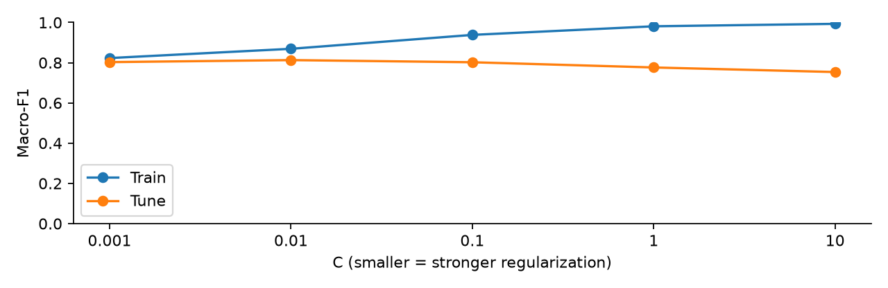
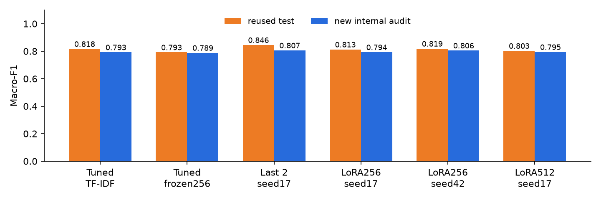
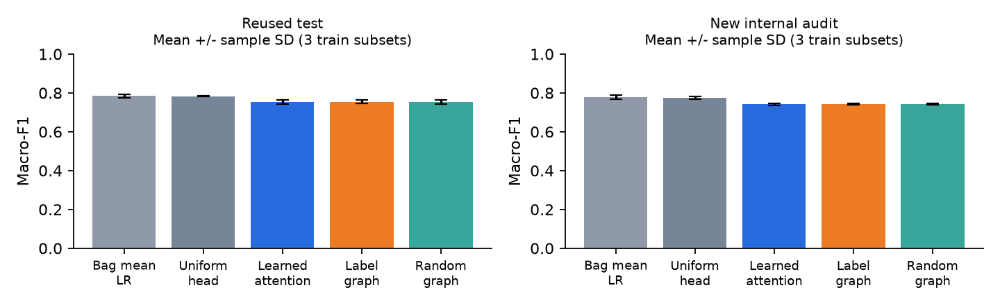
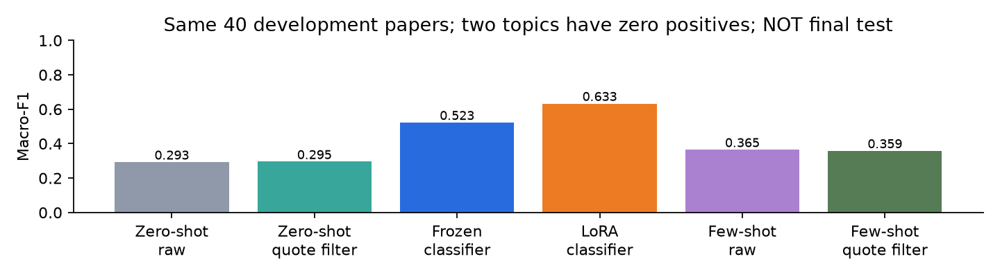

# 추가 개발 최종 기록: 진단 → 미세조정 → 긴 문헌 → 검토 서비스

V2 완료 후 추가 단계 시작: 2026-11-04 14:33:52 KST / 종료: 2026-11-04 16:25:38 KST / 실제 경과 111.7분. 표시 시각은 사용자 시간대인 KST이며 원시 UTC 기록도 보존했다. 불필요한 대기를 추가하지 않고 실험·검증을 수행했다.

## 1. 기존 결과 보존과 핵심 원인
V1 baseline을 그대로 보존했다. 최초 frozen BiomedBERT의 저성능을 모델 자체의 한계로 단정하지 않고 분류기 규제·입력 길이·pooling·encoder 적응을 분리했다. C1에서 C.01로 규제를 강하게 하자 train/tune 간격이 줄고, 같은 seed17 재사용 테스트 Macro-F1이 .7484→.7927로 개선됐다. 최초 저성능에 분류기 과적합이 영향을 줬다는 근거다.

## 2. 실제 결과 전체 비교
| 조건 | 분할 | Macro-F1 | Micro-F1 |
|---|---|---:|---:|
| V1_tfidf | test | 0.7716 | 0.8388 |
| V1_biomedbert | test | 0.7484 | 0.8040 |
| tuned_frozen256 | test | 0.7927 | 0.8556 |
| tfidf_full_refit | test | 0.7716 | 0.8388 |
| tfidf_truncated256 | test | 0.8023 | 0.8312 |
| mean512 | test | 0.7893 | 0.8644 |
| mean512 | audit | 0.7964 | 0.8718 |
| cls512 | test | 0.7818 | 0.8431 |
| cls512 | audit | 0.8029 | 0.8655 |
| v1_frozen256 | audit | 0.7662 | 0.8240 |
| tuned_frozen256 | audit | 0.7989 | 0.8665 |
| tfidf_full_refit | audit | 0.7833 | 0.8486 |
| tfidf_truncated256 | audit | 0.7919 | 0.8418 |
| last2_seed17 | test | 0.8460 | 0.8831 |
| last2_seed17 | audit | 0.8144 | 0.8780 |
| lora_seed17 | test | 0.8132 | 0.8721 |
| lora_seed17 | audit | 0.8087 | 0.8672 |
| lora_seed42 | test | 0.8190 | 0.8737 |
| lora_seed42 | audit | 0.7760 | 0.8677 |
| lora512_seed17 | test | 0.8034 | 0.8713 |
| lora512_seed17 | audit | 0.7940 | 0.8690 |
| tuned_tfidf_full | test | 0.8176 | 0.8549 |
| tuned_tfidf_full | audit | 0.8115 | 0.8612 |
| tuned_tfidf_truncated256 | test | 0.8060 | 0.8404 |
| tuned_tfidf_truncated256 | audit | 0.7837 | 0.8431 |
| threshold_cv_lora256_seed17 | test | 0.8132 | 0.8721 |
| threshold_cv_lora256_seed17 | audit | 0.8087 | 0.8672 |
| threshold_cv_lora512_seed17 | test | 0.7946 | 0.8738 |
| threshold_cv_lora512_seed17 | audit | 0.7961 | 0.8750 |
| v1_frozen256 | final_internal_audit1000 | 0.7474 | 0.8076 |
| v1_tfidf | final_internal_audit1000 | 0.7707 | 0.8440 |
| tuned_frozen256 | final_internal_audit1000 | 0.7889 | 0.8539 |
| mean512 | final_internal_audit1000 | 0.7805 | 0.8560 |
| cls512 | final_internal_audit1000 | 0.7847 | 0.8410 |
| tuned_tfidf_full | final_internal_audit1000 | 0.7930 | 0.8540 |
| tuned_tfidf_truncated256 | final_internal_audit1000 | 0.7700 | 0.8390 |
| last2_seed17 | final_internal_audit1000 | 0.8068 | 0.8785 |
| lora_seed17 | final_internal_audit1000 | 0.7937 | 0.8597 |
| lora_seed42 | final_internal_audit1000 | 0.8056 | 0.8728 |
| lora512_seed17 | final_internal_audit1000 | 0.7951 | 0.8652 |
| attention_seed17 | final_internal_audit1000 | 0.7410 | 0.8412 |
| label_graph_seed17 | final_internal_audit1000 | 0.7410 | 0.8412 |
| random_graph_seed17 | final_internal_audit1000 | 0.7423 | 0.8410 |
| uniform_attention_seed17 | final_internal_audit1000 | 0.7720 | 0.8453 |
| bag_mean_seed17 | final_internal_audit1000 | 0.7769 | 0.8465 |
| attention_seed42 | final_internal_audit1000 | 0.7369 | 0.8420 |
| label_graph_seed42 | final_internal_audit1000 | 0.7389 | 0.8411 |
| random_graph_seed42 | final_internal_audit1000 | 0.7404 | 0.8409 |
| uniform_attention_seed42 | final_internal_audit1000 | 0.7839 | 0.8482 |
| bag_mean_seed42 | final_internal_audit1000 | 0.7699 | 0.8254 |
| attention_seed73 | final_internal_audit1000 | 0.7446 | 0.8438 |
| label_graph_seed73 | final_internal_audit1000 | 0.7446 | 0.8438 |
| random_graph_seed73 | final_internal_audit1000 | 0.7446 | 0.8438 |
| uniform_attention_seed73 | final_internal_audit1000 | 0.7682 | 0.8430 |
| bag_mean_seed73 | final_internal_audit1000 | 0.7894 | 0.8491 |
| threshold_cv_lora256_seed17 | final_internal_audit1000 | 0.7937 | 0.8597 |
| threshold_cv_lora512_seed17 | final_internal_audit1000 | 0.7968 | 0.8666 |
| bag_mean_3seed_mean | test | 0.7847 ± 0.0083 | 0.8540 |
| bag_mean_3seed_mean | audit | 0.7928 ± 0.0079 | 0.8537 |
| bag_mean_3seed_mean | final_internal_audit1000 | 0.7787 ± 0.0099 | 0.8403 |
| uniform_attention_3seed_mean | test | 0.7830 ± 0.0030 | 0.8548 |
| uniform_attention_3seed_mean | audit | 0.7888 ± 0.0062 | 0.8560 |
| uniform_attention_3seed_mean | final_internal_audit1000 | 0.7747 ± 0.0082 | 0.8455 |
| attention_3seed_mean | test | 0.7529 ± 0.0097 | 0.8505 |
| attention_3seed_mean | audit | 0.7511 ± 0.0105 | 0.8559 |
| attention_3seed_mean | final_internal_audit1000 | 0.7408 ± 0.0039 | 0.8423 |
| label_graph_3seed_mean | test | 0.7536 ± 0.0085 | 0.8507 |
| label_graph_3seed_mean | audit | 0.7513 ± 0.0102 | 0.8547 |
| label_graph_3seed_mean | final_internal_audit1000 | 0.7415 ± 0.0029 | 0.8420 |
| random_graph_3seed_mean | test | 0.7529 ± 0.0099 | 0.8493 |
| random_graph_3seed_mean | audit | 0.7477 ± 0.0130 | 0.8537 |
| random_graph_3seed_mean | final_internal_audit1000 | 0.7424 ± 0.0021 | 0.8419 |

final_internal_audit1000은 모든 모델·프롬프트를 고정한 뒤 선택한 새 내부1,000편이다. 이 결과로 재튜닝하지 않았으며 모델/정책 해시를 선택 전에 보존했다. V1 3seed 평균과 V2 seed17 한 번의 결과를 섞어 비교하지 않는다. test2,488편은 V1부터 재사용한 개발 평가다. audit1,000편은 V2에서 처음 분리한 내부 확인 표본이며 V3에서는 다시 사용했다. V3를 완전히 새로운 맹검 외부 검증으로 주장하지 않는다.

## 3. 최종 일회 내부 감사 및 실제 미세조정
V2: 마지막2개 block seed17, 모든 층 LoRA seed17/42. V3: LoRA max512 seed17 추가. partial은 원본 마지막2개 block을, LoRA는 모든층에 추가한 query/value 저랭크 가중치를 task BCE로 업데이트했다. partial3epoch/LoRA1epoch 예산 안에서 tune600으로 checkpoint와 threshold를 선택했고, calibration/test/audit로 고르지 않았다. V2의 처음/마지막 block 가중치 변화는 verification.json에 있다. partial은3epoch/eager/attention dropout.1, LoRA는1epoch/SDPA/attention dropout0이므로 학습량과 구조가 함께 다른 비교다. LoRA256과 LoRA512는 epoch·LR schedule·attention/dropout을 맞췄으나 physical batch와 padding·cache 관리는 다르다. 512 미완료 시도는 보존하고 fixed512 padding/25optimizer step마다 MPS cache 정리를 적용해 재시작했다. 이때 dropout RNG·연산 순서와 호스트 부하도 달라질 수 있다. V3 max512는 읽는 길이와 계산 비용이 함께 증가한다. 하나의 추가 seed 결과이므로 일반적인 우열을 증명하지 않는다.

## 4. 논문 공부에서 더 확장한 문헌 bag 실험
문헌을 최대4개 token window의 bag으로 표현했다. frozen encoder로 각 조각을 벡터화한 뒤 bag mean LR, 같은 학습 조건의 균등 head, 주제별 attention, 실제 관계 규제, 무작위 관계 규제를 비교했다. 균등 head와 학습 attention은 query의 학습 여부만 다르게 두고 optimizer·dropout·epoch 선택을 맞췄다. 평균 LR과 attention의 차이를 attention 하나의 효과로 해석하지 않는다. 각 조건을3개 학습 부분표본에서 반복했다. 관계 규제는 classifier weight를 가깝게 하는 후속 구성이고, T-MDML의 distance metric/triplet 학습 재현은 아니다.
라벨별 attention은 어떤 조각에 비중을 주었는지 살펴보는 도구다. 정답 근거나 인과적 설명을 보장하지 않는다. 4개보다 많은 window는 균등 선택하여 원문 전체를 항상 읽지는 않는다. 검증 선택 조건이 많아져 선택 과적합 가능성도 남긴다.

## 5. 생성형 LLM의 실제 효과
무료 Qwen3-4B-4bit를 로컬 MLX로 실행했다. 고정40편에서 JSON 유효율 100.0%, 인용 규칙 통과율 79.1%, 지연 중앙값 7.72초, p95 16.22초.
- llm_raw_topics: Macro-F1 0.2927, Micro-F1 0.4421
- llm_verified_topics: Macro-F1 0.2952, Micro-F1 0.4419
- frozen_classifier_same40: Macro-F1 0.5230, Micro-F1 0.7255
- finetuned_classifier_same40: Macro-F1 0.6331, Micro-F1 0.8785

train-only 예시 3개를 고정한 추가 in-context 대조: JSON 100.0%, 인용 규칙 통과 79.4%, 지연 중앙값 11.28초. 같은40편이고 재시도/오류를 본 뒤 예시 선택을 하지 않았다. Qwen 가중치 미세조정은 아니다.
- fewshot_raw_topics: Macro-F1 0.3648, Micro-F1 0.4833
- fewshot_verified_topics: Macro-F1 0.3585, Micro-F1 0.4528

개발용40편의 탐색 실험이며 최종 test 성능이 아니다. 분류기는4,000편의 과제 학습과 최대256 BERT token, Qwen은 zero/few-shot과 최대1,600 Qwen token의 현재 문헌을 사용했다. 같은 문헌의 pipeline 비교이지 학습·입력·계산 예산을 맞춘 모델 계열 우열 실험은 아니다. 원문에 있는 문장인지 검사해도 의미적 entailment를 검증한 것은 아니다. 분류기 예측을 LLM에 보여주지 않았으며 invalid 출력도 all-negative 오류로 포함했다. LLM의 결과가 낮거나 인용을 잘못 내면 그대로 실패로 기록했다.

## 6. 확률 보정은 정확도와 별도
calibration400으로 scalar temperature를 binary NLL에 맞췄다. threshold도 같은 단조 함수로 변환하여 분류 결과를 유지했다. 따라서 F1은 의도적으로 변하지 않는다. 확률 품질 NLL/Brier/ECE가 개선되는지를 별도로 평가했다.
- test: NLL 0.1383→0.1388, Brier 0.0405→0.0407, macro ECE 0.0262→0.0251; 결정 불변=True
- audit: NLL 0.1286→0.1297, Brier 0.0369→0.0371, macro ECE 0.0162→0.0172; 결정 불변=True

확률 보정이 모든 문헌에서 정확성을 보장하거나 데이터 분포가 바뀌어도 유지된다는 주장은 하지 않는다.

## 7. 실제 검토 workflow
문헌 내용 해시+모델 checkpoint 버전으로 저장을 구분한다. AI 예측과 사람 검토 라벨은 별도 필드다. SQLite에 저장해 재시작 후 유지하고, 예상 revision이 오래되면409를 반환해 덮어쓰기를 방지한다. 원문에 없는 근거 인용·알 수 없는 라벨을 거절한다. 동일 문헌 중복 등록은 같은 ID를 반환하지만 등록 전 모델 추론 비용까지 중복 제거하는 job queue는 구현하지 않았다.
실제 미세조정 모델을 연결한 API smoke와 DB 동시성·revision·재시작·원문 인용 경계 검사를 수행한다. 검토 입력은 실험용 정답 라벨을 사용한 smoke이며 실제 사람이 운영 환경에서 평가한 결과가 아니다.

## 8. 제출할 때 설명하기
“처음 결과가 낮게 나온 원인을 분류기 과적합·입력 표현·과제 적응으로 나눠 조사했습니다. 무료 모델을 실제 미세조정하고 기존 결과와 새 내부 감사 결과를 함께 보존했습니다. 논문에서 배운 bag·라벨 관계 개념을 문헌 attention 및 관계 규제로 확장했고, 생성형 LLM 인용 검증과 사람 검토 workflow까지 연결했습니다.”
점수 개선 여부·비용·실패 조건을 위 표에 맞춰 설명한다. 오래 연구한 것처럼 개발 기간을 소급하지 않고, 기존 이론 학습과 이번 구현을 구분한다.

## 9. 주요 한계
- V1 이후 동일 테스트를 반복 사용했다. V2 audit도 V3에서는 재사용됐다.
- 데이터는 COVID-19 문헌7개 주제이고, 다른 과학 도메인·금융 문서로 일반화하지 않았다.
- 학습 표본4,000편과 제한된 seed/epoch에서의 결과다. SOTA 비교가 아니다.
- LLM40편과 confidence calibration은 소규모 탐색이며 의미적 인용 검증·인간 사용성 시험을 대신하지 않는다.
- 긴 입력과 bag 비교는 compute/input coverage가 달라 완벽한 단일 원인 실험이 아니다.

## 참고한 원문·공식 문서
- BiomedBERT 모델: https://huggingface.co/microsoft/BiomedNLP-BiomedBERT-base-uncased-abstract
- frozen embedding 해석: https://aclanthology.org/2022.findings-emnlp.314/
- 관련 pooling 연구: https://aclanthology.org/2023.emnlp-main.359/
- attention MIL: https://proceedings.mlr.press/v80/ilse18a.html
- attention 설명 평가: https://aclanthology.org/N19-1357/ 및 https://aclanthology.org/D19-1002/
- probability calibration: https://proceedings.mlr.press/v70/guo17a.html
- T-MDML AAAI2025: https://doi.org/10.1609/aaai.v39i17.33963 (Kim, Kan, Yi;39(17),17850–17858)
- LoRA: https://arxiv.org/abs/2106.09685

## 완료 실행의 학습 비용
| 조건 | 선택 epoch | 학습 실행 분 | 학습 대상 파라미터 | physical batch × accumulation |
|---|---:|---:|---:|---|
| last2_seed17 | 3 | 18.65 | 14,181,127 | 8 × 2 |
| lora_seed17 | 1 | 12.96 | 300,295 | 16 × 1 |
| lora_seed42 | 1 | 14.57 | 300,295 | 16 × 1 |
| lora512_seed17 | 1 | 42.42 | 300,295 | 4 × 4 |
완료된 각 실행의 학습·epoch 검증·checkpoint 저장 구간이며, 사전 모델 적재·입력 토큰화·최종 test/audit 추론은 별도다. 중단한 실행의 비용은 여기에 합산하지 않고 별도 로그와 전체 개발 경과에 남겼다. 같은 desktop host의 부하가 달랐고 partial3epoch/LoRA1epoch, padding·attention backend도 달라 일반적인 모델 속도 우열로 해석하지 않는다. 512 재시작은 fixed512 padding과25optimizer step마다 cache 정리를 사용했다. host memory/swap 관측도 results에 보존했다.

## 긴 입력 결과의 후속 진단
가중치나 선택 임계값을 바꾸지 않고 순위 AP·F1·TP/FP/FN을 분리했다. 기존 테스트에서 유행 예측·증례의 recall은 늘었지만 오탐도 늘었다. 이것은 관측한 결정의 손익이며 길이·batch·padding 등의 인과 효과를 분리한 증명이 아니다.
| 분할 | 조건 | Macro-F1 | Macro-AP |
|---|---|---:|---:|
| test | lora_seed17 | 0.8132 | 0.8946 |
| test | lora512_seed17 | 0.8034 | 0.8973 |
| audit | lora_seed17 | 0.8087 | 0.8746 |
| audit | lora512_seed17 | 0.7940 | 0.8698 |
세부 주제의 임계값·TP/FP/FN·AP·검증 support는 long_input_diagnosis.json에 있다. 표현의 순위와 결정 지표가 다르게 움직일 수 있으며 임계값 숫자는 서로 다른 score 분포에서 직접 비교할 수 없다.

## 검증 내부 교차분할로 임계값 안정화
512의 기존 테스트 결과를 본 뒤 추가한 개발 대조다. tune600 내부5fold에서 공통/라벨별 threshold의 혼합 lambda를 선택하고600편 전체로 다시 고정했다. CAL400·test·audit로 고르지 않았다. 가중치·확률은 그대로이고 결정 규칙만 달라지므로 temperature scaling과 구분한다. lambda1이면 기존 라벨별 정책이 그대로 선택된 것이며 API 기본 정책을 바꾸지 않았다.
- threshold_cv_lora256_seed17: lambda=1, 공통 threshold=0.30, 내부5fold 평균 Macro-F1=0.7898. 최종 새 감사 결과는 전체 표에 별도로 보존했다.
- threshold_cv_lora512_seed17: lambda=0, 공통 threshold=0.35, 내부5fold 평균 Macro-F1=0.8015. 최종 새 감사 결과는 전체 표에 별도로 보존했다.

## 최종 내부 감사의 고정 비교와 불확실성
| 미리 정한 비교 | Macro-F1 차이 | 문헌 paired bootstrap95% 구간 |
|---|---:|---|
| tuned_frozen256 minus v1_frozen256 | 0.0414 | [0.0157, 0.0640] |
| last2_seed17 minus v1_frozen256 | 0.0593 | [0.0283, 0.0910] |
| lora_seed17 minus tuned_tfidf_full | 0.0007 | [-0.0334, 0.0333] |
| lora512_seed17 minus lora_seed17 | 0.0015 | [-0.0171, 0.0229] |
| attention_seed17 minus uniform_attention_seed17 | -0.0310 | [-0.0648, 0.0029] |
| label_graph_seed17 minus random_graph_seed17 | -0.0013 | [-0.0056, 0.0013] |
| threshold_cv_lora512_seed17 minus lora512_seed17 | 0.0017 | [-0.0182, 0.0191] |
| last2_seed17 minus tuned_tfidf_full | 0.0138 | [-0.0196, 0.0452] |
라벨별 support: {'Treatment': 337, 'Diagnosis': 246, 'Prevention': 434, 'Mechanism': 177, 'Transmission': 46, 'Epidemic Forecasting': 26, 'Case Report': 91}. 문헌 재표집만의 불확실성이며 모델/설정 선택·도메인 변화는 포함하지 않는다. 다중 비교 보정 없는 서술적 구간이고 전반적 우월성의 검정으로 해석하지 않는다.

## LLM 실패를 지표별로 분리
인용 규칙 통과율은 알려진 라벨·15~240자·원문 및 모델에 보인 입력과의 정확 일치를 모두 검사한다. 원래 JSON의 verbatim_evidence_rate 필드는 이 복합 규칙의 통과율이며, 순수한 원문 substring 비율과 구분한다. 불일치는 사실적 환각과 같은 뜻이 아니다.
- zero_shot: 원문 substring 자체의 일치 86.0%; 전체 인용 규칙 통과 34/43. 길이/비일치 사유(중복 가능) {'quote_length_outside_15_240': 5, 'not_verbatim_in_original': 6}. 필터가 제거한 맞는 라벨 2개 / 오탐 7개.
- few_shot: 원문 substring 자체의 일치 89.7%; 전체 인용 규칙 통과 54/68. 길이/비일치 사유(중복 가능) {'quote_length_outside_15_240': 8, 'not_verbatim_in_original': 7}. 필터가 제거한 맞는 라벨 5개 / 오탐 9개.
이40편에는 Transmission·Epidemic Forecasting 정답이0개였다. 전체7라벨 Macro-F1은 이 두 라벨의 F1=0을 포함한다. 모든 조건에 동일한 규칙을 적용했으며, Micro-F1·라벨별 support도 함께 보고한다. 다른 분할의 F1과 직접 비교하지 않는다.

## 고정 bag 모델의 작동 진단
| 조건 | 선택 lambda | 선택 epoch | train/tune Macro 차이 | audit 정규화 attention entropy | 규제/BCE 비율 |
|---|---:|---:|---:|---:|---:|
| attention_seed17 | 0 | 29 | 0.0834 | 0.7720 | 0 |
| label_graph_seed17 | 0 | 29 | 0.0834 | 0.7720 | 0 |
| random_graph_seed17 | 0.1 | 29 | 0.0821 | 0.7715 | 0.0136884 |
| uniform_attention_seed17 | 0 | 16 | 0.0275 | 1.0000 | 0 |
| attention_seed42 | 0 | 27 | 0.0526 | 0.7767 | 0 |
| label_graph_seed42 | 0.1 | 29 | 0.0609 | 0.7747 | 0.0134122 |
| random_graph_seed42 | 0.1 | 28 | 0.0634 | 0.7752 | 0.0130915 |
| uniform_attention_seed42 | 0 | 26 | 0.0421 | 1.0000 | 0 |
| attention_seed73 | 0 | 23 | 0.0599 | 0.7775 | 0 |
| label_graph_seed73 | 0 | 23 | 0.0599 | 0.7775 | 0 |
| random_graph_seed73 | 0 | 23 | 0.0599 | 0.7775 | 0 |
| uniform_attention_seed73 | 0 | 10 | 0.0075 | 1.0000 | 0 |
entropy1은 거의 균등,0은 집중이다. lambda0이면 관계 규제를 사용하지 않은 모델이 선택된 것이다. 규제/BCE는 선택 모델 eval-mode의 서술 통계로 확률적 학습 loss와 동일하지 않으며, 작은 값만으로 성능 변화 원인을 증명하지 않는다.

토큰 조각 제거 민감도: 기존 audit 중 chunk2개 이상 911편, 원본 Macro-F1 0.7818.
- highest_attention: Macro-F1 0.5018, 라벨 하나 이상 전환 61.0%, 평균 절대 확률 변화 0.2191.
- lowest_attention: Macro-F1 0.6569, 라벨 하나 이상 전환 21.1%, 평균 절대 확률 변화 0.0480.
- random: Macro-F1 0.5646, 라벨 하나 이상 전환 36.9%, 평균 절대 확률 변화 0.1183.
이는 고정 모델의 masking 민감도이며 원문 인용의 정당성이나 attention의 인과적 설명력을 검증한 것은 아니다. 처음10개 적격 사례를 자동 저장했다.

## 실제 LoRA 배포 검증
같은32 calibration 문헌·batch8·warm-up·3반복. 고정 순서 실행이므로 일반적인 배속으로 해석하지 않는다.
최대 확률 차이 8.3446503e-07, 문헌별 라벨집합 일치 100.0%. 처리량과 메모리 원시 수치는 results/merge_benchmark.json에 보존했다. 원본 checkpoint는 수정하지 않았다.
- lora_seed17: adapter+head 1.207MB / 원본 포함 checkpoint 439.2MB. tensor round-trip 정확 일치. 별도 base model이 필요하므로 전체 모델 크기 축소라고 쓰지 않는다.
- lora_seed42: adapter+head 1.207MB / 원본 포함 checkpoint 439.2MB. tensor round-trip 정확 일치. 별도 base model이 필요하므로 전체 모델 크기 축소라고 쓰지 않는다.
- lora512_seed17: adapter+head 1.207MB / 원본 포함 checkpoint 439.2MB. tensor round-trip 정확 일치. 별도 base model이 필요하므로 전체 모델 크기 축소라고 쓰지 않는다.

## 최종 산출물 무결성 확인
V1 원본 46개 파일과 최종 평가 전에 고정한 63개 파일 해시가 그대로였다. 새 내부 표본의 28개 조건 점수를 저장된 확률·고정 threshold로 다시 계산해 일치함을 확인했다. PMID와 정규화 텍스트 해시는 기존 표본과 겹치지 않았다.
DOI가 있는 969편의 기존 표본 중복은0이었다. 나머지 31편은 DOI가 없어 PMID·텍스트 해시만 확인했다. 의미적 근접 중복까지 검증한 것은 아니다.
LoRA512의 원본 encoder199개 대조 텐서는 정확히 유지됐고, adapter B norm과 checkpoint 해시를 확인했다. uniform head3개의 query가 실제 저장 가중치에서도0인지 확인했고, CV 임계값 분기는 원래 모델과 확률 배열이 완전히 같았다. 검사는 result JSON의 재서술이 아니라 실제 가중치·예측·원본 ID와의 대조를 포함한다.