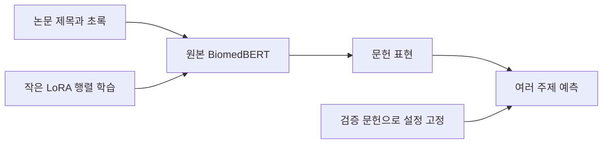

# 후속 실험을 내가 설명하기

## 처음 결과를 어떻게 해석해야 하나?

'BiomedBERT가 단순 모델보다 나쁘다'는 결론은 너무 빨랐습니다. 처음에는 언어모델 가중치를 고정하고 나온 숫자 벡터에 분류기 하나를 학습했습니다. 그 분류기가 학습 데이터에 지나치게 맞춰졌을 가능성이 있었습니다.

## 실제로 무엇을 바꿨나?

같은 벡터·같은 데이터에서 분류기 규제 강도를 비교했습니다. C가 작을수록 분류기가 과하게 복잡해지는 것을 억제합니다. C1에서는 학습 점수 .981/검증 .776이었고, C.01에서는 학습 .869/검증 .813이었습니다. 학습 점수는 낮아져도 처음 보는 문헌을 더 잘 맞힐 수 있었습니다. 검증으로 선택한 설정의 재사용 테스트 Macro-F1은 .748→.793이었습니다.

## 그래도 새 모델이 좋아졌다고만 쓰면 되나?

아닙니다. 테스트 결과를 이미 보고 후속 개발을 시작했기 때문에 이번 테스트는 독립적인 최종 확인으로 보기 어렵습니다. 그래서 이전 학습에 쓰지 않은 공식 train의 1,000편을 추가 감사 표본으로 분리했습니다. 감사 결과는 별도로 확인합니다. 같은 데이터 출처이므로 완전히 새로운 외부 병원·연구 분야 검증도 아닙니다.

## 미세조정은 이전과 뭐가 다른가?

이전에는 언어모델을 고정했습니다. 이번에는 문헌 주제를 맞히도록 언어모델의 원본 일부 또는 추가 LoRA 가중치를 실제로 학습합니다. 마지막2개 층만 바꾸는 모델, 원본을 고정하고 모든층 query/value에 작은 저랭크 가중치를 추가하는 LoRA 모델, 다른 학습 표본에서 다시 학습한 모델을 비교합니다. 학습 로그뿐 아니라 실제 층의 가중치가 변했는지도 검사합니다. encoder를 전혀 바꾸지 않는 작은 분류기 학습과 구분합니다.

## epoch는 많을수록 좋나?

한 epoch는 학습 문헌을 한 번 보는 것입니다. 부분 미세조정은3번 학습하며 epoch별 검증 점수로 선택했고, LoRA는 compute 예산에 따라1번만 학습했습니다. 마지막 epoch나 테스트 점수가 가장 높은 epoch를 고르는 것이 아닙니다. 학습 loss가 내려가도 검증은 나빠질 수 있습니다.

## 왜 입력 길이를 실험하나?

기존 모델은 최대256 token만 읽었습니다. token은 글자나 단어와 정확히 같지 않은 모델의 단위입니다. 문헌 끝에 중요한 내용이 있을 수 있어512를 비교합니다. 하지만 이번 TF-IDF는 잘랐을 때 점수가 올라가기도 했습니다. 모든 정보를 넣는 게 항상 더 좋은 것은 아니고, 불필요한 단어·vocabulary 변화도 영향을 줄 수 있습니다.

## 생성형 LLM은 무슨 역할인가?

로컬 Qwen3-4B에게 문헌 주제와 원문 근거 문장을 JSON으로 추출하게 합니다. 분류기와 별개의 AI이며, 40편의 고정된 검증 문헌에서 비교합니다. 문장이 원문에 실제 있는지 서버에서 검사합니다. 원문과 일치하는 문장이라고 그 라벨을 논리적으로 지지한다는 뜻은 아니므로, 인용 일치율과 주제 분류 점수를 따로 봅니다.

## '원인을 찾았다'고 얼마나 말할 수 있나?

규제 강도만 바꾼 비교는 분류기 과적합이 영향을 줬다는 근거입니다. 입력 길이·pooling·미세조정은 별도 비교의 결과를 봐야 합니다. 여러 설정을 검증에서 골랐기 때문에 선택 편향이 있고, 모델의 본질적인 우열이나 모든 데이터에서의 성능을 증명하지는 않습니다.

최종 수치·원인별 결과는 REPORT.md에 기록합니다. V1은 실패를 포함한 최초 실험, V2는 원인을 조사해 개선한 후속 개발로 설명합니다.

## LoRA는 쉽게 말하면?

큰 원본 행렬을 전부 다시 배우는 대신, 각 attention 층에 작은 두 행렬을 덧붙여 문헌 주제에 맞게 조정하는 것입니다. 이번 모델은 원본 encoder를 고정하고 query/value에 rank8 adapter를 추가했습니다. 학습 대상은 약30만 개 파라미터이며, 기존 원본 마지막2개 층을 학습하는 방식과는 다릅니다. 원본이 고정됐는지와 adapter가 실제 바뀌었는지는 코드로 확인합니다.

## 내가 설명할 때 피할 표현

- “전체 모델을 모두 학습했다”: 전체 원본 학습은 비용 때문에 중단했고, 완료된 것은 부분 미세조정과 LoRA입니다.
- “LoRA가 무조건 더 좋다”: 학습량·dropout도 달라 조건별 결과를 봐야 합니다.
- “인용을 붙였으니 정답이다”: 원문 일치와 의미적 정당성은 다릅니다.
- “새로운 테스트로 증명했다”: 기존 test 재사용과 내부 감사 표본의 범위를 구분합니다.
- “논문을 재현했다”: 원논문에서 배운 질문을 별도 데이터·후속 모델로 실험했습니다.
