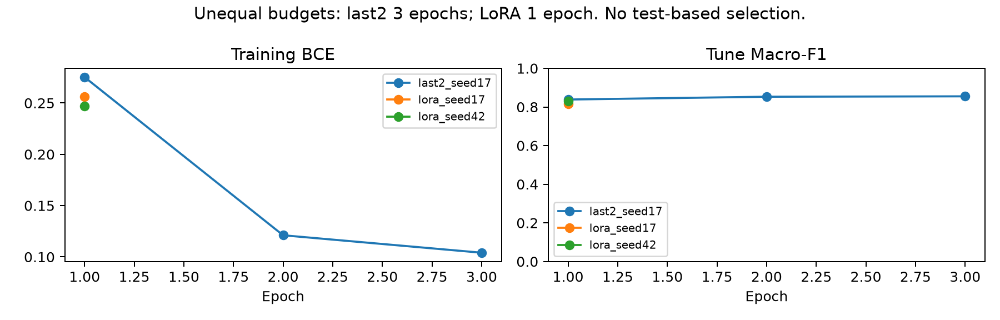

# V2: BiomedBERT 저성능 원인 진단과 무료 미세조정

V1 최초 실험을 보존한 후속 개발. 재사용 테스트와 새 내부 감사 표본을 구분한다.

## 1. 이미 확인한 원인: 분류기 과적합
같은 frozen256 표현과 학습 표본에서 규제를 바꿨다. StandardScaler+C1은 train Macro-F1 .981 / tune .776, C.01은 train .869 / tune .813이었다. tune으로 고른 C.01의 기존 test 결과는 .7927로 V1 seed17 .7484보다 높았다. 모델 표현을 바꾸지 않고도 개선돼, 최초 저성능의 일부가 분류기 설정에 기인한다는 근거다. 원인 전체를 설명하거나 독립 외부 재현을 의미하지는 않는다.

## 2. 입력 길이와 pooling
| 분할 | 길이 중앙값 | 256 초과 | 512 초과 |
|---|---:|---:|---:|
| train | 288 | 58.4% | 5.5% |
| dev | 284 | 60.1% | 5.9% |
| test | 315 | 70.8% | 5.0% |
| audit | 284 | 58.0% | 5.3% |

TF-IDF 256제한은 BiomedBERT tokenizer로 잘라 단어를 복원했다. 잘림뿐 아니라 vocabulary 구성이 변하므로 순수한 길이 효과라고 단정하지 않는다. 512 mean/CLS는 같은 forward에서 계산해 그 둘의 pooling 비교는 길이를 맞췄다.

## 3. 최종 결과 비교
| 모델 | 평가 분할 | Macro-F1 | Micro-F1 | Hamming loss |
|---|---|---:|---:|---:|
| V1 frozen256 seed17 | reused test | 0.7484 | 0.8040 | 0.0775 |
| V1 TF-IDF seed17 | reused test | 0.7716 | 0.8388 | 0.0649 |
| tuned_frozen256 | test | 0.7927 | 0.8556 | 0.0586 |
| tfidf_full_refit | test | 0.7716 | 0.8388 | 0.0649 |
| tfidf_truncated256 | test | 0.8023 | 0.8312 | 0.0685 |
| mean512 | test | 0.7893 | 0.8644 | 0.0545 |
| mean512 | audit | 0.7964 | 0.8718 | 0.0494 |
| cls512 | test | 0.7818 | 0.8431 | 0.0628 |
| cls512 | audit | 0.8029 | 0.8655 | 0.0523 |
| v1_frozen256 | audit | 0.7662 | 0.8240 | 0.0683 |
| tuned_frozen256 | audit | 0.7989 | 0.8665 | 0.0520 |
| tfidf_full_refit | audit | 0.7833 | 0.8486 | 0.0583 |
| tfidf_truncated256 | audit | 0.7919 | 0.8418 | 0.0621 |
| last2_seed17 | test | 0.8460 | 0.8831 | 0.0466 |
| last2_seed17 | audit | 0.8144 | 0.8780 | 0.0471 |
| lora_seed17 | test | 0.8132 | 0.8721 | 0.0527 |
| lora_seed17 | audit | 0.8087 | 0.8672 | 0.0523 |
| lora_seed42 | test | 0.8190 | 0.8737 | 0.0511 |
| lora_seed42 | audit | 0.7760 | 0.8677 | 0.0511 |

test는 이미 V1에서 본 2,488편이다. audit는 기존 선택/학습에 쓰지 않은 공식 train 문헌1,000편이다. 감사 표본의 라벨로 설정을 선택하지 않았다. 동일 데이터 원천의 내부 IID 표본이며 완전히 새로운 외부 검증은 아니다. 서로 다른 seed의 학습 표본도 달라 점수 차이를 단순한 초기화 효과로 해석하지 않는다.

## 4. 실제 가중치 미세조정

mean pooling+dropout+linear multi-label head, BCEWithLogitsLoss, partial encoder LR2e-5 / LoRA LR5e-4 / head1e-3, effective batch16, max256, partial3epoch/LoRA1epoch. 마지막2개 block의 원본 가중치를 학습한 조건과 모든12개 block query/value에 LoRA를 붙인 seed17/42를 비교했다. 원본 전체 가중치 학습은 비용 때문에 중단했으며 성공 결과로 세지 않는다. 모든 checkpoint/threshold 선택은 tune600에서만 수행했다.
- last2_seed17: 선택 epoch 3, tune Macro-F1 0.8551, requires_grad 파라미터 14,181,127, 학습 18.7분. requires_grad 수는 optimizer 대상이며 사용하지 않는 pooler는 실제 gradient를 받지 않을 수 있다.
- lora_seed17: 선택 epoch 1, tune Macro-F1 0.8162, requires_grad 파라미터 300,295, 학습 13.0분. requires_grad 수는 optimizer 대상이며 사용하지 않는 pooler는 실제 gradient를 받지 않을 수 있다.
- lora_seed42: 선택 epoch 1, tune Macro-F1 0.8310, requires_grad 파라미터 300,295, 학습 14.6분. requires_grad 수는 optimizer 대상이며 사용하지 않는 pooler는 실제 gradient를 받지 않을 수 있다.

가중치 변화 검사:
- last2_seed17: 마지막 block 변화 L2=1.072726, 첫 block=0.000000, LoRA B norm 합=0.000000, 원본 변경 텐서=32개.
- lora_seed17: 마지막 block 변화 L2=0.000000, 첫 block=0.000000, LoRA B norm 합=19.724697, 원본 변경 텐서=0개.
- lora_seed42: 마지막 block 변화 L2=0.000000, 첫 block=0.000000, LoRA B norm 합=19.261476, 원본 변경 텐서=0개.

MPS의 SDPA dropout 미지원 오류를 보존하고 eager attention으로 재시작했다. 실패 실행을 성공 학습으로 세지 않았다. partial은3epoch/eager/attention dropout.1, LoRA는1epoch/SDPA/attention dropout0을 사용하므로 학습량과 층 수만의 순수 비교가 아니다. 원래 masked-LM head가 남긴 unexpected key는 mean-pooled encoder로 다른 task를 만들 때 사용하지 않는 출력 head이며, 실제 encoder 가중치는 사전학습 상태로 적재했다.

## 5. 생성형 LLM을 덧붙인 실제 검증
무료 로컬 mlx-community/Qwen3-4B-4bit. calibration400 중 문헌 해시로 미리 고정한40편에 zero-shot 주제·원문 인용을 요청했다. 분류기 예측을 보여주지 않았다. JSON 유효율 100.0%, 출력 인용의 인용 규칙 통과율 79.1%, 지연 중앙값 7.72초/p95 16.22초.
| 방식 | 같은40편 Macro-F1 | Micro-F1 |
|---|---:|---:|
| llm_raw_topics | 0.2927 | 0.4421 |
| llm_verified_topics | 0.2952 | 0.4419 |
| frozen_classifier_same40 | 0.5230 | 0.7255 |
| finetuned_classifier_same40 | 0.6331 | 0.8785 |

이40편은 개발용 calibration의 일부라 최종 테스트 성능으로 쓰지 않는다. 분류기는4,000편 과제 학습/최대256 BERT token, Qwen은 zero-shot/최대1,600 Qwen token을 사용한 pipeline 비교다. 학습·입력 예산을 맞춘 모델 계열 우열 실험이 아니다. Transmission·Epidemic Forecasting 정답이0개라 전체7라벨 Macro-F1은 이 두 라벨의0점을 포함하며 같은40편 조건끼리 비교한다. invalid/empty 출력은 all-negative로 평가했다. 원래 JSON의 verbatim_evidence_rate는 알려진 라벨·15~240자·원문 및 모델 입력과의 정확 일치라는 복합 인용 규칙의 통과율이다. 순수한 원문 substring 비율과 다르며, 길이 위반을 사실적 환각으로 부르지 않는다. 인용 원문 일치는 의미적 entailment나 모델 설명의 충실성을 보장하지 않는다. JSON parsing만 통과한 출력과 근거 검증 후 출력을 구분했다.

## 6. 원인별로 말할 수 있는 범위
- 규제: 같은 표현에서 train/tune 간격이 줄고 후속 평가가 개선됐다. 분류기 과적합이 최초 결과에 영향을 줬다는 직접 근거다.
- 입력 길이: 256/512과 matched pooling의 결과로 판단한다. 길게 읽으면 항상 좋아진다고 가정하지 않는다.
- 과제 적응: 실제 encoder weight update 및 frozen 대비 결과를 확인한다. fine-tuning의 optimizer/head/dropout도 함께 달라지므로 표현 변화 하나만의 순수한 인과 효과라고 과장하지 않는다.
- 생성형 LLM: 원문 근거 추출 도구로 쓸 가능성을 소규모 개발 실험으로 확인한다. LLM을 붙였다는 사실만으로 정확성이 개선된다고 쓰지 않는다.

## 7. 보존·재현
V1 46개 파일의 SHA256이 실행 전과 동일하다. 원본 결과·PDF·모델을 덮어쓰지 않았다. 감사 표본의 PMID/텍스트 해시는 기존 train/dev/test와 겹치지 않는다.
실행 순서: diagnose.py → finetune.py → input_ablation.py → llm_review.py → verify_v2.py → report_v2.py. GPU 모델은 순차 실행했다. V2 inference: PYTHONPATH=followup_v2/src uvicorn api_v2:app --host 127.0.0.1 --port8768.

## 8. 설명 문장
“처음 frozen BiomedBERT가 TF-IDF보다 낮게 나왔지만 모델 자체의 한계로 단정하지 않고, 규제·입력 길이·pooling·과제 적응을 분리해 조사했습니다. 기존 결과를 보존하고 무료 로컬 미세조정 및 별도 감사 평가를 수행했으며, 생성형 LLM의 주제·근거 추출도 같은 문헌에서 비교했습니다.”

수치는 결과표에 맞춰 추가하고, 본인이 실제로 이해·검증한 범위로 설명한다.

## 출처
- 모델: https://huggingface.co/microsoft/BiomedNLP-BiomedBERT-base-uncased-abstract
- text classification fine-tuning 공식 문서: https://huggingface.co/docs/transformers/tasks/sequence_classification
- frozen embedding 해석의 주의점: https://aclanthology.org/2022.findings-emnlp.314/
- 관련 pooling 연구: https://aclanthology.org/2023.emnlp-main.359/

## 고정 모델의 paired bootstrap 및 오류 전환
| 분할 | 비교 | Macro-F1 차이 | 문헌 bootstrap95% 구간 | 완전정답으로 수정 | 기존 완전정답 손상 |
|---|---|---:|---|---:|---:|
| test | tuned_minus_v1 | 0.0443 | [0.0256, 0.0625] | 333 | 129 |
| test | last2_seed17_minus_v1 | 0.0975 | [0.0771, 0.1185] | 463 | 116 |
| test | lora_seed17_minus_tuned | 0.0204 | [0.0006, 0.0408] | 252 | 159 |
| audit | tuned_minus_v1 | 0.0327 | [0.0011, 0.0651] | 116 | 44 |
| audit | last2_seed17_minus_v1 | 0.0483 | [0.0183, 0.0780] | 158 | 48 |
| audit | lora_seed17_minus_tuned | 0.0097 | [-0.0238, 0.0433] | 83 | 75 |
문헌 재표집에 따른 불확실성만 나타내며, 설정 선택·학습 표본·새 도메인에 대한 불확실성을 포함하지 않는다. 사례는 고정 순서의 최초 오류를 자동 선택했다. 라벨별 FP/FN과 실제 사례는 finetuning_error_analysis.json에서 확인한다.
- PMID 34201687 / last2_seed17 / test: 정답 ['Prevention', 'Transmission'], 예측 ['Prevention'], 누락 ['Transmission'], 오탐 [].
- PMID 34203847 / last2_seed17 / test: 정답 ['Treatment'], 예측 ['Prevention'], 누락 ['Treatment'], 오탐 ['Prevention'].
- PMID 34346709 / last2_seed17 / test: 정답 ['Transmission'], 예측 ['Prevention', 'Transmission'], 누락 [], 오탐 ['Prevention'].
- PMID 34133805 / last2_seed17 / test: 정답 ['Prevention'], 예측 ['Diagnosis', 'Prevention'], 누락 [], 오탐 ['Diagnosis'].